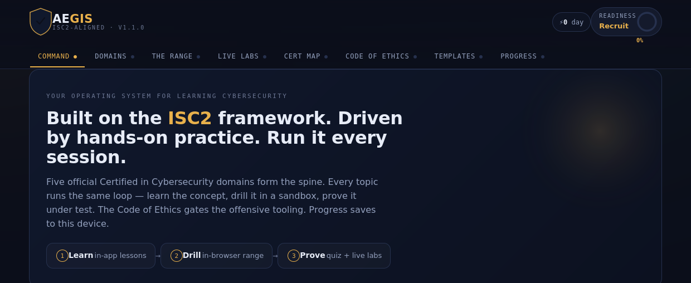

# AEGIS — ISC2-Aligned Cybersecurity Learning System




A self-contained cybersecurity range built on the ISC2 framework. AEGIS turns the five **Certified in Cybersecurity (CC)** domains into a guided **learn → drill → prove** loop: read the lesson, practice it hands-on, then pass the domain quiz at 80%.

It's an installable **Progressive Web App** — add it to your phone's home screen and it runs full-screen and **offline**, like a native app. No build step, no dependencies. Progress saves on-device.

---

## Features

- **In-app lessons** — plain-language explanations with diagrams and worked examples. Every Beginner objective across all five domains is covered, plus all of Domain 1.
- **7 hands-on trainers** — SOC terminal, subnet/CIDR calculator, incident-response simulator, least-privilege workshop, phishing triage, ethics tribunal, and a mixed exam bank. All in-browser, no setup.
- **Per-domain quizzes** with a real **80% pass gate**, drawn from a 38-question bank.
- **Code of Ethics gate** — the offensive trainers unlock only after you accept the four ISC2 canons.
- **Certification map** — CC → SSCP → CISSP → CCSP, alongside Security+, CySA+, CEH, CISM, and OSCP.
- **Difficulty flags** — every objective, trainer, and lab is tagged Beginner / Intermediate / Advanced, with a filter.
- **Progress tracking** — study streak, spaced-repetition review queue, and field notes, saved locally.

## The trainers

| Trainer | Domain | What you do |
|---|---|---|
| SOC Terminal | 5 · Security Ops | Simulated Linux shell — hunt a brute-force attack in the auth log, verify file integrity |
| Subnet & CIDR Trainer | 4 · Networking | Compute network/broadcast addresses, host counts, and masks with real IPv4 math |
| Incident Response Sim | 2 · BC/DR/IR | Branching ransomware scenario scored on making the right calls in order |
| Least-Privilege Workshop | 3 · Access Controls | Provision a new analyst with exactly the access they need — nothing more |
| Phishing Triage | 5 · Awareness | Flag phishing vs. legitimate mail and name the red flags |
| Ethics Tribunal | 1 · Ethics | Decide which ISC2 canon governs each gray-area dilemma |
| CC Exam Bank | All | 12-question mixed exam across every domain |

## Install on your phone (Galaxy S25+ / Android)

Once the app is live on the web (see **Deploy** below), on your S25+:

1. Open the page in **Chrome**.
2. Tap it around a bit so Chrome sees it's a real app — an **"Install AEGIS"** button appears bottom-right, or use the browser menu (⋮) → **Add to Home screen / Install app**.
3. Confirm. AEGIS lands on your home screen with its own icon and launches full-screen.
4. After the first load it works **offline** — no signal needed to study.

> iPhone/iPad: open in **Safari**, tap **Share → Add to Home Screen**.

## Deploy with GitHub Pages (free hosting + HTTPS)

A PWA needs HTTPS; GitHub Pages provides it automatically. This repo ships a
**GitHub Actions workflow** (`.github/workflows/deploy.yml`) that publishes the
site on every push to `main` — no manual steps after the one-time setup.

**Recommended — automatic (GitHub Actions):**

1. Create a repository (e.g. **`aegis`**) and upload the contents of this folder to the repo root (`index.html` at the top level).
2. In the repo: **Settings → Pages → Build and deployment → Source → GitHub Actions**.
3. Push any commit (the initial upload counts). The **Deploy AEGIS to GitHub Pages** workflow runs automatically under the **Actions** tab.
4. When it finishes (~1 min), your app is live at:
   `https://<your-username>.github.io/aegis/`

From then on, every push auto-deploys. You can also trigger it manually from
**Actions → Deploy AEGIS to GitHub Pages → Run workflow**.

**Alternative — no workflow (deploy from a branch):**

Delete `.github/` if you prefer, then **Settings → Pages → Source: Deploy from a
branch → `main` / `/ (root)`**. Same URL, but you manage it manually.

## Versioning & releases

The app shows its version in the header and footer, and greets you with a
**"What's new"** changelog screen whenever the version changes (tap **What's new**
in the footer to reopen it). To cut a new release, bump all three in lockstep:

- `APP_VERSION` in `index.html`
- the top entry of `CHANGELOG` in `index.html` (what changed)
- `CACHE` in `sw.js` (e.g. `aegis-v1.2.0`) — this is what tells installed apps to refresh their offline cache

## Run it locally (no phone / no hosting)

Just open `index.html` in any browser. Everything works except the install prompt and offline caching, which require HTTPS. Progress still saves via `localStorage`.

## Repository layout

```
aegis/
├─ index.html               ← the entire app
├─ manifest.webmanifest     ← PWA metadata (name, icons, theme)
├─ sw.js                    ← service worker (offline app shell)
├─ icons/                   ← app icons (192, 512, maskable, apple-touch)
├─ docs/screenshot.png      ← README image (swap for your own capture)
├─ .github/workflows/
│  └─ deploy.yml            ← auto-deploys to GitHub Pages on every push
├─ README.md
├─ LICENSE
└─ .gitignore
```

> The screenshot is the app's landing view. To use your own, take a capture on
> your S25+ (**Power + Volume Down**) and replace `docs/screenshot.png`.

## Tech notes

- One HTML file for the app: inline CSS + vanilla JavaScript, zero runtime dependencies.
- Service worker caches the app shell for offline use; state lives in `localStorage` (reset control on the Progress tab).
- Fonts load from Google Fonts online and fall back to a system stack offline.
- No tracking, no analytics.

## Roadmap

- [ ] Intermediate lessons — SIEM, hardening, encryption, VPNs, packet analysis, routing, NAC, RTO/RPO, separation of duties, DAC/MAC/RBAC
- [ ] Advanced networking lessons — SDN/microsegmentation, ZTNA/SASE, BGP security & RPKI, deep packet inspection, covert-channel detection
- [ ] Cumulative mock exam — 25 questions weighted across domains with a per-domain breakdown
- [ ] Packet-capture triage trainer (spot C2 beaconing in a simulated PCAP)
- [ ] Firewall ruleset builder · passphrase-entropy visualizer

## Contributing

Because it's a single file, the whole app is in one place — no toolchain to set up. Welcome PRs: new lessons (follow the `LESSONS` object), new quiz questions (add to `QUIZ` with a `Domain N ·` label so they map automatically), new trainers, and accuracy fixes against the current ISC2 outline.

## Disclaimer

AEGIS is an **independent study aid**. It is **not affiliated with, endorsed by, or sponsored by ISC2**. "CC," "SSCP," "CISSP," "CCSP," and related names are trademarks of their respective owners, used here only to describe the material.

Practice offensive techniques **only** against systems you own or are explicitly authorized to test. Unauthorized scanning or access is illegal under laws such as the U.S. CFAA — mirroring Canon I and Canon II of the ISC2 Code of Ethics.

## License

Released under the **MIT License** — see [`LICENSE`](LICENSE). Remember to replace `<your name>` in the license file.
